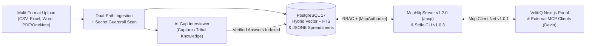

# Horizon VelitIQ

**Enterprise Banking Knowledge Continuity, Active Offboarding Governance & Agentic MCP Hybrid RAG Platform**

[](https://dotnet.microsoft.com/)
[](https://nextjs.org/)
[](https://www.postgresql.org/)
[](https://www.nuget.org/profiles/Keerthi_RB)

---

## Executive Overview

**Horizon VelitIQ** is an enterprise knowledge capture and retrieval platform designed to safeguard institutional continuity when subject-matter experts depart the bank. Rather than treating offboarding as an unstructured file archive, VelitIQ enforces **`Department -> Team -> Departing Employee`** governance, performs **format-intelligent ingestion** across heterogeneous banking documents (`CSV`, `Excel`, `Word`, `PDF / OneNote Exports`), actively interviews departing staff via **AI Gap Elicitation** to capture unwritten tribal knowledge, and exposes grounded answers through both a **Scoped Web Copilot** and a standards-compliant **Model Context Protocol (MCP) Server**.



---

## Management & Engineering Documentation Suite

All business, architectural, security, deployment, and IDE onboarding documentation is maintained in the [`docs/`](docs/) directory:

| Document | Audience | Contents |
| :--- | :--- | :--- |
| **[01. Executive Vision & Strategy](docs/01_EXECUTIVE_VISION_AND_STRATEGY.md)** | Management, ARB & Product Leadership | Business problem, why standard Vector RAG fails on bank spreadsheets/tribal knowledge, persona workflows, and On-Premises to Azure roadmap. |
| **[02. System Architecture & Flows](docs/02_SYSTEM_ARCHITECTURE_AND_FLOWS.md)** | Enterprise Architects & Lead Engineers | Component topology, end-to-end sequence diagrams (Ingestion, Gap Re-Indexing, Agentic MCP Loop), RRF mathematical ranking, and PostgreSQL ER schema. |
| **[03. Security, RBAC & Governance](docs/03_SECURITY_RBAC_AND_GOVERNANCE.md)** | InfoSec, Risk, Compliance & Audit | Active Directory (LDAP & Windows SSO) to Entra ID federation, Chinese-wall access matrix (`TeamOnly`, `DepartmentShared`, `BankWideShared`), `[McpAuthorize]`, Secret Scanner, and Audit Logs. |
| **[04. Deployment & Office Cutover](docs/04_DEPLOYMENT_AND_OFFICE_CUTOVER.md)** | DevOps, DBAs & Platform Engineers | Step-by-step office setup (`AzureFoundry` URL/Key, AD/LDAP, PostgreSQL 17 on Windows Server, IIS/Service hosting, Devin Desktop MCP config, and zero-rewrite Azure migration). |
| **[05. Developer & IDE Reference](docs/05_DEVELOPER_AND_IDE_REFERENCE.md)** | Software Engineers & Office AI IDEs | Complete monorepo map, REST API & MCP Tool/Resource/Prompt contracts, and extension recipes. |
| **[AGENTS.md](AGENTS.md)** | Office AI Coding Agents (Devin, Cursor, Copilot, Antigravity) | Domain invariants, configuration seams, and build/verification commands for safe automated code modifications on the office network. |

---

## Core Capabilities Summary

* **Hierarchical `Department -> Team -> User` Categorization & Chinese Walls:** Isolates confidential team models (`TeamOnly`) while enabling controlled `DepartmentShared` and `BankWideShared` artifacts plus `Admin` and `CrossTeamViewer` (Internal Audit/Risk) oversight.
* **Dual-Path Multi-Format Parsing:**
  * **Excel (`.xlsx`/`.xls`) & CSV (`.csv`):** Extracts worksheets, infers column types, catalogs **Excel cell formulas (`=SUM(...)`, `=D2-E2`, cross-sheet refs)**, and stores rows in PostgreSQL `JSONB` for exact `SUM`/`AVG`/`MIN`/`MAX` aggregations via MCP.
  * **Word (`.docx`):** Preserves heading hierarchies (`H1 -> H2 -> H3`) and converts Word tables to clean Markdown.
  * **PDF & Exported OneNote Notebooks (`.pdf`):** Reconstructs spatial page/column layouts and extracts embedded diagrams/screenshots for multimodal **Azure AI Foundry Vision** analysis.
* **Active Handover Gap Elicitation & Readiness Scoring:** Generates Executive Handover Dossiers, `0–100%` Exit Readiness Scores, and targeted follow-up questions upon upload; author answers are immediately embedded and indexed into Hybrid RAG.
* **Powered by [`Keerthi_RB`](https://www.nuget.org/profiles/Keerthi_RB) `.NET 10` MCP Libraries:**
  * [`McpHttpServer` `v1.2.0`](https://www.nuget.org/packages/McpHttpServer) — Hosts `/mcp` Streamable HTTP (`2024-11-05` through `2026-07-28`), RFC 9728 OAuth 2.0 discovery, SEP-2663 Tasks, and zero-reflection `[McpAuthorize]` guards.
  * [`Mcp.Client.Net` `v1.0.1`](https://www.nuget.org/packages/Mcp.Client.Net) — Drives `AgenticRagOrchestrator` over `StreamableHttpClientTransport` with caller Bearer JWT propagation.
  * [`Keerukee.MCPServer.Stdio` `v1.0.3`](https://www.nuget.org/packages/Keerukee.MCPServer.Stdio) — Powers `VelitIQ.Mcp.Cli` for local desktop/IDE STDIO MCP access.

---

## Quick Start

### 1. Run Locally (Zero Cloud API Keys Required)
```powershell
.\scripts\start-dev.ps1
```
* **Web Portal:** `http://localhost:3000`
* **REST Health Diagnostics:** `http://127.0.0.1:5180/api/health`
* **Streamable HTTP MCP Endpoint:** `http://127.0.0.1:5180/mcp`

### 2. Configure for Bank Office Network (`backend/src/VelitIQ.Api/appsettings.json`)
Populate `AzureFoundry:AzureOpenAiUrl`, `AzureFoundry:ApiKey`, and `Auth:Ldap` as documented in **[04. Deployment & Office Cutover](docs/04_DEPLOYMENT_AND_OFFICE_CUTOVER.md)**.

### 3. Run Automated Verification Suite
```powershell
dotnet test VelitIQ.sln
```
