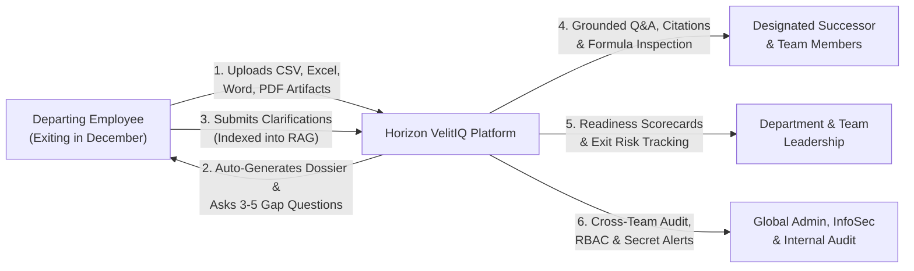

# 01. Executive Vision, Business Case & Product Strategy

**Document Classification:** Management & Architecture Review Board (ARB) Briefing  
**Platform Name:** Horizon VelitIQ — Enterprise Knowledge Continuity & Agentic MCP Platform  
**Target Milestone:** December Offboarding Knowledge Capture & Continuity Readiness  

---

## 1. Executive Summary

Financial institutions face acute operational, regulatory, and continuity risk when experienced engineers, treasury operations leads, and quantitative risk specialists depart within a concentrated window. Critical institutional memory—spanning **end-of-day (EOD) batch recovery procedures**, **SWIFT/Fedwire cut-off exceptions**, **multi-sheet Excel reconciliation formulas**, **exported OneNote architecture notebooks**, and **unwritten escalation protocols**—is routinely fragmented across local drives or lost entirely upon employee exit.

**Horizon VelitIQ** transforms employee offboarding from a passive "file dump" into a **governed, intelligent, and verifiable institutional knowledge asset**:

1. **Structured Organizational Taxonomy (`Department -> Team -> Departing Employee`):** Organizes every artifact by business unit, team, departing SME, and designated successor while strictly enforcing banking **Chinese-wall access controls**.
2. **Multi-Modal, Format-Aware Knowledge Ingestion:** Automatically processes **CSV**, **Excel (`.xlsx`/`.xls`)**, **Word (`.docx`)**, and **PDF (including exported OneNote notebooks)**—preserving both narrative context and exact spreadsheet formulas/rows.
3. **Active AI Offboarding Elicitation ("AI Handover Interviewer"):** Proactively audits uploaded documents upon ingestion to identify missing context, undefined acronyms, or undocumented formula thresholds, prompting the departing employee with targeted clarification questions *before* their exit date.
4. **Enterprise Agentic Hybrid RAG via Model Context Protocol (MCP):** Powered by the `.NET 10` **`Keerthi_RB` MCP NuGet Suite**, successors, managers, and approved AI desktop clients (such as Devin Desktop) query grounded institutional knowledge with inline citations, exact spreadsheet calculations, and zero cross-team data leakage.

---

## 2. Why Conventional "Vector-Only RAG" Is Insufficient for Banking

| Banking Reality | Failure Mode of Standard Vector RAG | Horizon VelitIQ Solution |
| :--- | :--- | :--- |
| **Financial & Risk Spreadsheets (`Excel` / `CSV`)** | Token chunking severs column headers from cell values, discards Excel formulas (`=SUM(...)`, cross-sheet lookups), and hallucinates totals. | **Dual-Path Ingestion:** Indexes workbook schemas & formula catalogs semantically *and* loads structured rows into PostgreSQL `JSONB` for exact `SUM`/`AVG`/`MIN`/`MAX` SQL execution via MCP tools. |
| **Exact Banking Identifiers (`SWIFT_MT103`, `PRD-GL-04`, `GL_9999`)** | Pure dense vector embeddings dilute exact alphanumeric job codes, hostnames, and GL account numbers. | **Contextual Hybrid Search (RRF):** Combines dense vector cosine similarity with PostgreSQL `tsvector` GIN full-text lexical ranking via **Reciprocal Rank Fusion (RRF)**. |
| **Unwritten Tribal Knowledge** | Passive RAG can only retrieve what departing staff remembered to write down in existing files. | **Active Gap Elicitation:** Generates targeted follow-up questions at upload time; author answers are immediately embedded as verified, boosted knowledge chunks. |
| **Strict Regulatory Chinese Walls** | Single shared vector pools risk surfacing confidential Risk or Trading parameters to unauthorized teams. | **Multi-Tier RBAC (`TeamOnly`, `DepartmentShared`, `BankWideShared`):** Enforced at both the REST API layer and MCP protocol boundary (`[McpAuthorize]`), backed by Active Directory / Entra ID security groups. |
| **Accidental Credential Uploads** | Departing engineers may inadvertently upload scripts or CSVs containing database passwords or API keys. | **Automated Guardrail Scanner:** Scans every uploaded artifact for connection strings, private keys, tokens, and SSN patterns, alerting Governance Admins with redacted previews. |

---

## 3. Target Personas & Value Proposition

* **Departing Employees:** Guided, low-friction upload studio that synthesizes their Executive Handover Dossier automatically and captures critical edge cases in minutes via structured Q&A.
* **Designated Successors & Team Peers:** Day-1 self-service **Agentic MCP Copilot** capable of answering operational recovery questions, explaining Excel formulas, and generating 30-day onboarding plans with verifiable citations.
* **Team Leads & Program Directors:** Live **December Readiness Dashboard** (`0–100%` readiness scoring per employee and per team) providing objective visibility into handover completeness ahead of December exit dates.
* **Global Admins, Risk & Internal Audit:** Centralized governance over Department/Team hierarchies, Active Directory to Entra ID group mappings, cross-team shared policies, credential leak alerts, and an immutable security audit log.

---

## 4. Phased Infrastructure Strategy (On-Premises Now -> Azure Target State)

To meet the urgent **December offboarding deadline** without blocking on cloud provisioning approvals, VelitIQ is engineered around clean infrastructure abstractions:

| Capability | Phase 1: Immediate On-Premises Deployment | Phase 2: Target Azure Cloud Cutover (Config-Only Switch) |
| :--- | :--- | :--- |
| **Compute Hosting** | On-Premises **Windows Server** (IIS or Native Windows Service) | **Azure App Service** / **Azure Container Apps** |
| **Database & Hybrid Index** | **PostgreSQL 17** on Windows Server (`tsvector` GIN + `pgvector` or `.NET 10` SIMD Cosine) | **Azure Database for PostgreSQL Flexible Server** (Native `pgvector` HNSW enabled) |
| **AI Model Backend** | **Azure AI Foundry** (`AzureOpenAiUrl` + `ApiKey` over bank network) + Offline Dev Fallback | **Azure AI Foundry** (Managed Identity / Private Endpoint) |
| **Identity & Directory** | **On-Prem Active Directory** (LDAP Bind + Windows Integrated SSO) | **Microsoft Entra ID** (OIDC / OAuth 2.0 Bearer JWTs) |
| **Artifact Storage** | Windows Server Local Disk / Secured Corporate UNC Share | **Azure Blob Storage** (`AzureBlobFileStorageService`) |

> [!IMPORTANT]
> Transitioning from the On-Premises Windows Server to Microsoft Azure requires **zero application code changes**—every infrastructure adapter switches cleanly via `appsettings.json` or environment variables.
