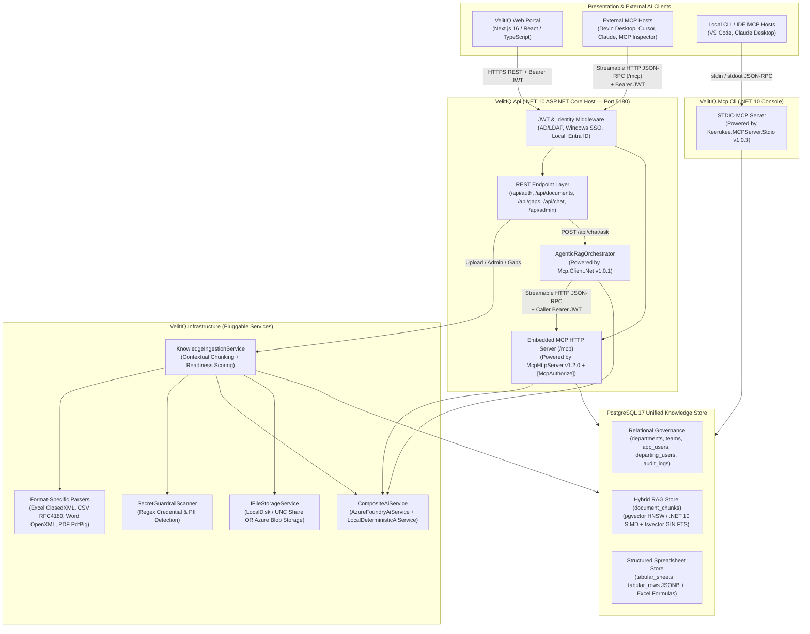
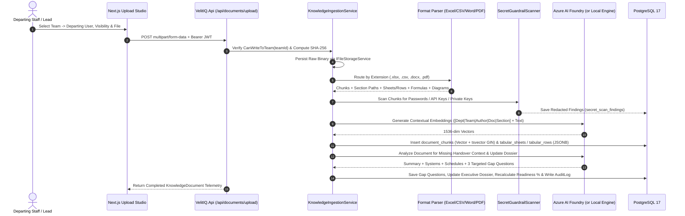
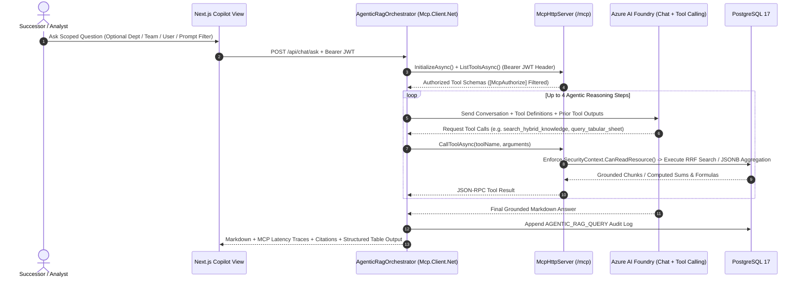
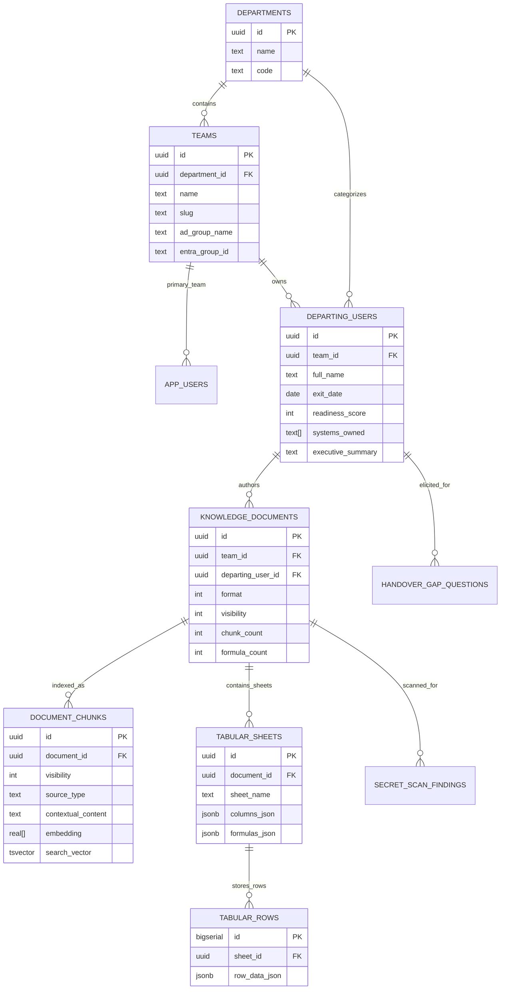

# 02. System Architecture, Data Flows & Database Design

**Document Classification:** Enterprise Architecture & Engineering Specification  
**Technology Stack:** `.NET 10.0` (ASP.NET Core), `Next.js 16` (React / TypeScript / Tailwind CSS), `PostgreSQL 17`, `Keerthi_RB` MCP NuGet Ecosystem  

---

## 1. End-to-End Component Architecture

Horizon VelitIQ follows a **Clean Modular Architecture** hosting both a high-performance REST API (for binary multipart uploads and portal administration) and a standards-compliant **Model Context Protocol (MCP) Streamable HTTP Server** (`/mcp`) inside a unified `.NET 10` deployment unit—eliminating microservice sprawl and message-broker dependencies on Windows Server.

---

## 2. Role of the `Keerthi_RB` NuGet Ecosystem

VelitIQ consumes three zero-dependency `.NET 10` libraries published under [`https://www.nuget.org/profiles/Keerthi_RB`](https://www.nuget.org/profiles/Keerthi_RB):

1. **`McpHttpServer` (`v1.2.0`)** in `VelitIQ.Mcp` & `VelitIQ.Api`:
   - Exposes `/mcp` over **Streamable HTTP**, negotiating MCP protocol versions `2024-11-05` through `2026-07-28` automatically.
   - Exposes `/.well-known/oauth-protected-resource` (RFC 9728) for OAuth 2.0 discovery.
   - Compiles `[McpAuthorize]` callbacks (`RequireAuthenticatedStaff`, `RequireGlobalAdmin`) into zero-reflection startup delegates that dynamically filter `tools/list` and guard `tools/call`, `resources/read`, and `prompts/get`.
   - Enables the **SEP-2663 Tasks Extension** (`io.modelcontextprotocol/tasks`).
2. **`Mcp.Client.Net` (`v1.0.1`)** in `VelitIQ.Mcp`:
   - Used by `AgenticRagOrchestrator` (`McpClientBuilder.ForStreamableHttp(...)`) to connect to `/mcp` with the logged-in user's JWT header.
   - Dynamically discovers authorized tools (`ListToolsAsync`), resolves prompt templates (`GetPromptAsync`), and executes multi-turn tool calls (`CallToolAsync`) so the web UI and external MCP clients share a single source of truth.
3. **`Keerukee.MCPServer.Stdio` (`v1.0.3`)** in `VelitIQ.Mcp.Cli`:
   - Provides a standalone STDIO server (`McpServerHost`) for local CLI and IDE integrations (`velitiq_search`, `velitiq_list_departing_staff`, `velitiq://stdio/info`).

---

## 3. Architectural Flow 1: Multi-Format Ingestion & Active Gap Elicitation

When a departing employee or team lead uploads a file (`CSV`, `Excel`, `Word`, or `PDF`), the backend executes a deterministic 7-stage pipeline:

### Format-Specific Extraction Details
* **Excel (`ExcelDocumentParser.cs`):** Uses `ClosedXML` (with `ExcelDataReader` fallback for legacy `.xls`) to iterate worksheets, infer column data types (`number`, `date`, `boolean`, `string`), compute `Min`/`Max`/`Sum` metadata, extract every cell's `FormulaA1` (`=D2-E2`, `=SUM(...)`, cross-sheet references) into a dedicated `FormulaCatalog` chunk, and store every row in `tabular_rows` (`JSONB`).
* **CSV (`CsvDocumentParser.cs`):** RFC-4180 streaming parser auto-detecting `,`, `;`, `\t`, and `|` delimiters, preserving quoted multi-line values, building typed column schemas, and populating both `tabular_rows` and batch text chunks.
* **Word (`WordDocumentParser.cs`):** Uses `DocumentFormat.OpenXml` to walk paragraphs and tables in document order, tracking `Heading1`–`Heading6` breadcrumbs and converting `<w:tbl>` elements into aligned Markdown tables.
* **PDF & OneNote Exports (`PdfDocumentParser.cs`):** Uses `PdfPig` word bounding boxes (`Bottom` / `Left` coordinates) to reconstruct horizontal lines and wide side-by-side OneNote canvas columns while extracting embedded diagram/screenshot PNGs (`page.GetImages()`) for multimodal **Azure AI Foundry Vision** transcription.

---

## 4. Architectural Flow 2: Human-in-the-Loop Gap Clarification Indexing

When a departing employee answers an AI-generated Handover Gap Question (`POST /api/gaps/{id}/answer`):
1. The answer is saved on `handover_gap_questions` with author attribution and timestamp.
2. `KnowledgeIngestionService.AnswerGapQuestionAndIndexAsync` wraps the Q&A pair in a contextual header (`SourceType = "AuthorGapAnswer"`), generates its embedding vector, and inserts it directly into `document_chunks`.
3. During future queries, `SearchHybridAsync` applies a `1.35x` Reciprocal Rank Fusion priority boost to matching `AuthorGapAnswer` chunks so verified author clarifications surface prominently alongside source documents.
4. The departing employee's **Executive Dossier** and **Readiness Score (`0–100%`)** are immediately recalculated.

---

## 5. Architectural Flow 3: Agentic MCP Hybrid RAG & Tabular Execution

### Hybrid Reciprocal Rank Fusion (RRF) Formula
For every candidate chunk authorized by `SecurityContext.CanReadResource(...)`, VelitIQ computes:
1. **Dense Vector Rank ($r_{\text{vec}}$):** Ranked by cosine similarity (`1 - (embedding_vec <=> query_vec)` via `pgvector` HNSW index when installed, or `.NET 10` hardware-accelerated SIMD `TensorPrimitives.CosineSimilarity` over `real[]`).
2. **Lexical Rank ($r_{\text{lex}}$):** Ranked by PostgreSQL `ts_rank_cd(search_vector, to_tsquery('english', ...))` backed by a stored `GIN` index.
3. **Fused Score ($k = 60$):**
   $$\text{Score}_{\text{RRF}} = \left(\frac{1}{60 + r_{\text{vec}}} + \frac{1.25}{60 + r_{\text{lex}}}\right) \times \beta_{\text{source}}$$
   where $\beta_{\text{source}} = 1.35$ for verified `AuthorGapAnswer` chunks and $1.0$ otherwise.

---

## 6. PostgreSQL 17 Entity-Relationship Model

