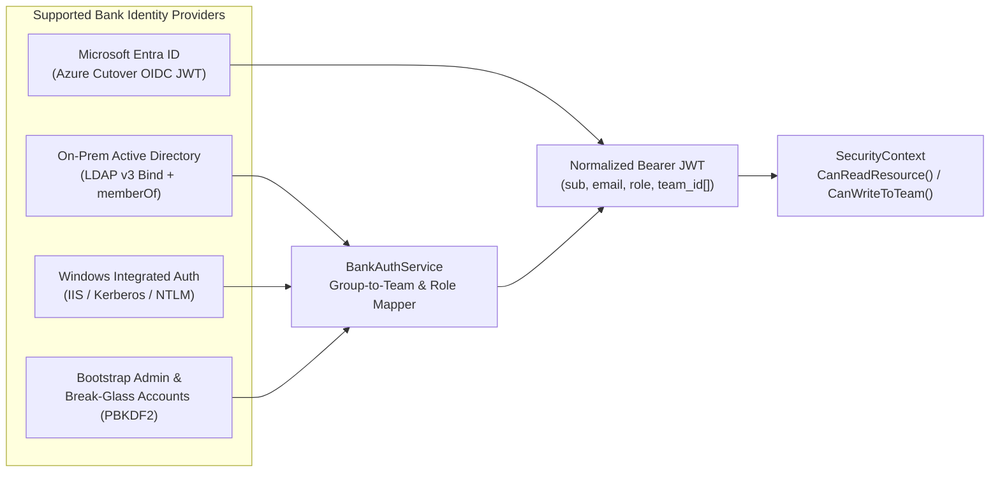

# 03. Security, Chinese-Wall RBAC & Banking Governance

**Document Classification:** Information Security, Risk & Compliance Review Dossier  
**Scope:** Identity Federation, Access Control Boundaries, MCP Protocol Security, Secret Guardrails & Auditability  

---

## 1. Identity Federation Architecture (On-Prem AD Now -> Azure Entra ID Later)

VelitIQ decouples authentication mechanisms from downstream authorization via a **Normalized JWT Claims Layer** (`SecurityContext`). Regardless of whether a user signs in via **On-Premises Active Directory (LDAP Bind)**, **Windows Integrated Domain SSO**, **Bootstrap Local Accounts**, or **Microsoft Entra ID OIDC**, all downstream REST endpoints and MCP tools evaluate the exact same claims structure.

### Active Directory Group-to-Team Resolution
* Each `Team` record in VelitIQ stores both:
  * `AdGroupName` (e.g., `CN=SG-VelitIQ-TreasuryOps`) for On-Premises Active Directory `memberOf` matching, and
  * `EntraGroupId` (e.g., `entra-grp-treasury-ops-001`) for future Azure Entra ID group claim resolution.
* Enterprise-wide administrative and oversight groups map via `Auth:Ldap:AdminGroupCn` (`CN=SG-VelitIQ-Admins` -> `UserRole.Admin`) and `Auth:Ldap:CrossTeamGroupCn` (`CN=SG-VelitIQ-CrossTeamViewers` -> `UserRole.CrossTeamViewer`).

---

## 2. Chinese-Wall Access Control Matrix (`Department -> Team -> User`)

Every ingested document, contextual chunk, and structured spreadsheet table inherits one of three `VisibilityScope` tiers:

1. **`TeamOnly` (Default — Strict Chinese Wall):** Visible exclusively to members of the owning `Team`, plus `CrossTeamViewer` (Internal Audit / Operational Risk) and `Admin`.
2. **`DepartmentShared`:** Visible to all teams belonging to the same `Department` (e.g., across multiple Technology platform teams), plus `CrossTeamViewer` and `Admin`.
3. **`BankWideShared`:** Explicitly designated shared reference material (e.g., Enterprise Holiday Payment Cut-off Calendars or Shared Gateway Architecture Notes) accessible to any authenticated bank employee.

| Role | Own Team (`TeamOnly`) | Same Dept (`DepartmentShared`) | Bank-Wide (`BankWideShared`) | Other Teams (`TeamOnly`) | Upload & Answer Gaps | Org & Audit Admin |
| :--- | :---: | :---: | :---: | :---: | :---: | :---: |
| **`Employee`** | Read & Query | Read & Query | Read & Query | **Blocked (`403`)** | Own Team Only | Denied |
| **`TeamLead`** | Read, Query & Toggle Visibility | Read & Query | Read & Query | **Blocked (`403`)** | Own Team + Register Exits | Denied |
| **`CrossTeamViewer`** | Read & Query | Read & Query | Read & Query | **Read & Query All** | Read-Only | View Audit & Alerts |
| **`Admin`** | **Full Read/Write** | **Full Read/Write** | **Full Read/Write** | **Full Read/Write** | **All Teams** | **Full Admin CRUD** |

---

## 3. Defense-in-Depth Enforcement Layers

### Layer 1: REST API Enforcement (`VelitIQ.Api`)
* Every endpoint (`/api/documents`, `/api/documents/{id}`, `/api/documents/{id}/download`, `/api/spreadsheets/query`, `/api/gaps`) resolves `SecurityContext` from the caller's verified JWT and checks `CanReadResource(departmentId, teamId, visibility)` or `CanWriteToTeam(teamId)`.
* Direct URL probing of restricted `TeamOnly` documents returns `HTTP 403 Forbidden` and writes an immutable `RBAC_DOCUMENT_ACCESS_DENIED` entry to `audit_logs`.

### Layer 2: MCP Protocol Enforcement (`McpHttpServer v1.2.0`)
* `[McpAuthorize(nameof(RequireAuthenticatedStaff))]` and `[McpAuthorize(nameof(RequireGlobalAdmin))]` compile to zero-reflection delegates at server startup:
  * **Discovery Filtering:** Unauthenticated callers see `0` sensitive tools in `tools/list`; non-admin staff never see `governance_audit_overview`.
  * **Execution Guarding:** Direct `tools/call` or `resources/read` attempts without required privileges are rejected at the protocol layer (`-32001`).
  * **OAuth 2.0 Discovery (RFC 9728):** Exposes `/.well-known/oauth-protected-resource` advertising supported authorization servers and scopes (`velitiq:knowledge.read`, `velitiq:knowledge.write`, `velitiq:admin`).

### Layer 3: Database Retrieval Pre-Filtering (`PostgresKnowledgeStore`)
* Hybrid search (`SearchHybridAsync`) and tabular sheet queries (`QueryTabularSheetAsync`) filter candidate rows through `caller.CanReadResource(...)` *prior* to Reciprocal Rank Fusion or aggregation, guaranteeing zero cross-team leakage in LLM context windows.

---

## 4. Upload Credential & PII Guardrails (`SecretGuardrailScanner`)

During offboarding, departing engineers occasionally upload runbooks or spreadsheets containing embedded credentials. `SecretGuardrailScanner` automatically inspects every extracted text chunk and spreadsheet cell against banking security rules:

| Rule Identifier | Severity | Target Pattern |
| :--- | :--- | :--- |
| `PrivateKeyMaterial` | **Critical** | `-----BEGIN [RSA/EC/OPENSSH] PRIVATE KEY-----` headers |
| `DatabaseOrStorageConnectionString` | **Critical** | `Password=...`, `Pwd=...`, `AccountKey=...`, `SharedAccessKey=...` |
| `CloudOrAiApiKey` | **Critical** | OpenAI (`sk-...`), Google (`AIza...`), GitHub (`ghp_...`) tokens |
| `HardcodedCredentialAssignment` | **Warning** | `api_key`, `client_secret`, `service_password`, `db_password` assignments |
| `PotentialSsnPattern` | **Warning** | Formatted US Social Security Number patterns (`XXX-XX-XXXX`) |

> [!NOTE]
> Raw secret values are **never** persisted to `secret_scan_findings` or logs—only masked previews (e.g., `Pass****99!`) and document/page locations are recorded for Governance Admin remediation.

---

## 5. Immutable Compliance Audit Trail (`audit_logs`)

All security-relevant operations are recorded in PostgreSQL (`audit_logs`) with timestamp, actor ID/email, role, client IP, target resource, and structured JSON metadata:
* `AUTH_LOGIN_AD_LDAP`, `AUTH_LOGIN_WINDOWS_SSO`, `AUTH_LOGIN_LOCAL`, `AUTH_LOGIN_DEMO_PERSONA`, `AUTH_LOGIN_FAILED`
* `DOC_INGEST_COMPLETED`, `DOC_DOWNLOAD`, `DOC_VISIBILITY_UPDATED`
* `HANDOVER_GAP_ANSWERED`
* `AGENTIC_RAG_QUERY` (records question and invoked MCP tools)
* `RBAC_DOCUMENT_ACCESS_DENIED`
